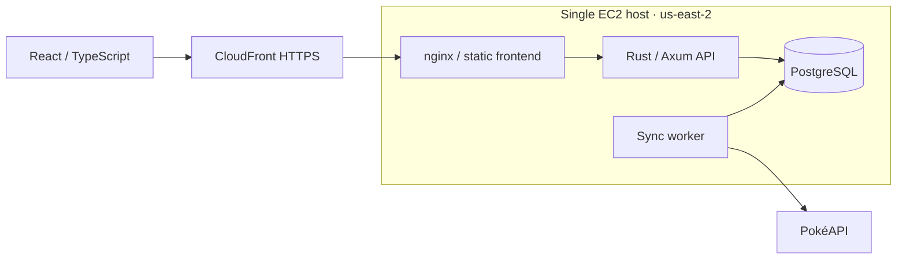

# Poketeam

A Pokémon team builder with counter-team recommendations and alerts for catalog changes affecting saved teams. Built as an interview case study, the goal was a working, enjoyable first version with room for extension.

[Live app](https://d2d00yusoq9i0z.cloudfront.net) · [Setup and project guide](docs/project-guide.md) · [API](docs/api.md) · [Operations](docs/operations.md)

## Design priorities

**Maintainability and time drove the project.** The aim was to deliver a useful experience while establishing a stable foundation for later features. Scope and infrastructure stayed small; extension points were added where they would preserve that foundation.

## Architecture

The API and worker run as separate processes from one Rust codebase and container image. Browser requests read the local catalog rather than calling PokéAPI.

## Decisions and tradeoffs

| Element | Reasoning | Accepted cost or limitation |
| --- | --- | --- |
| **Rust backend** | Resource-efficient deployment as a straightforward binary on small hardware. Compiler and type-system feedback also speed validation of AI-assisted changes. | Explicit, sometimes verbose code increases review volume. For this small application, compiler confidence was worth that overhead. |
| **React / TypeScript** | A familiar, commonly encountered stack. TypeScript catches certain classes of issues before runtime, following the same preference for early feedback. | Its guarantees are less strict than Rust's; types alone cannot establish that the application works. |
| **PostgreSQL / explicit SQL** | Several databases would have worked; PostgreSQL offered simple setup and room to grow. SQL is familiar across languages, avoids an ORM-specific learning curve, and can be debugged independently. | Queries, mappings, migrations, and database operations remain explicit maintenance work. |
| **Local catalog / incremental sync** | API errors and timeouts motivated a simple fetch loop that saves each Pokémon as it arrives. A usable partial product mattered more than optimizing I/O at this scale. | A refresh can leave mixed-age data. Daily refresh is a practical default for infrequently changing data, not a freshness guarantee. |
| **Counter recommendations** | The open-ended prompt left room for fun: type advantage and a stat-balanced Rival mode inspired by an opponent at a similar power level. | Moves, abilities, and levels were deliberately excluded to keep implementation simple. Recommendations are not battle predictions. |
| **Identity / extension** | Anonymous sessions got the app working without an external identity provider. Stable owners and separate device sessions leave a boundary for adding providers later. | Provider login, account linking, and cross-device sign-in remain deferred. |
| **Sprite loading** | Keep default sprites available and load cosmetic alternatives only when selected, avoiding unnecessary image imports after early sync-performance issues. | Additional images depend on their upstream host; the cached default provides a fallback. |
| **Hosting** | One EC2 host was chosen for simplicity and cost, with standard CloudFront providing HTTPS. | A single failure domain and deployment downtime; account credits and usage limits still apply. |
| **Validation** | Prioritize integration and smoke tests, especially the frontend/backend connection, to establish that connected workflows function. | Compiler checks and fixtures cannot establish production configuration; live deployment needs its own checks. |

Local caching and a modest refresh frequency also respect [PokéAPI's fair-use guidance](https://pokeapi.co/docs/v2#fairuse) for a shared public resource.

Setup, feature behavior, verification commands, and deeper references are in the [project guide](docs/project-guide.md). Implementation and deployment records are in [plans/](plans/); the live deployment can lag the repository.
